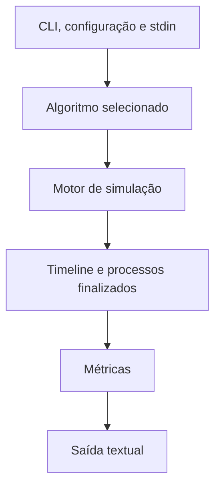

# Implementação do simulador

## 1. Objetivo e escopo

O projeto implementa em C17 um simulador de escalonamento de CPU para os sete
algoritmos previstos no enunciado da disciplina: FCFS, SJF, SRTF, prioridades
com e sem preempção, Round-Robin e Round-Robin com prioridade e aging. O escopo
atual compreende o núcleo em C, entrada textual, métricas, relatório textual e
testes. Não há modo JSON, servidor, interface web, animações ou gráficos.

## 2. Requisitos interpretados

Os processos são recebidos em `stdin` com instante de criação, duração e
prioridade estática. A lista pode estar fora de ordem de chegada. A prioridade
é uma escala positiva em que `1` é a maior prioridade. Quantum e aging vêm de
um arquivo de configuração. O simulador deve disponibilizar as métricas de
vida/turnaround e espera, as trocas de contexto e um diagrama temporal; o
tempo de resposta é fornecido como métrica adicional.

## 3. Arquitetura



`app` coordena a leitura, a seed, o algoritmo e a saída. Cada algoritmo cria
uma `Simulation` independente a partir da mesma `ProcessList` de origem. Ao
terminar, `metrics` verifica o resultado, e `output` o transforma em texto.
`main` apenas conecta a aplicação a `stdin`, `stdout` e `stderr`.

## 4. Módulos

| Módulo | Responsabilidade |
| --- | --- |
| `process` | parsing, validação, armazenamento e cópia de processos |
| `config` | parsing do arquivo `quantum`/`aging` |
| `cli` | interpretação de `--algorithm`, `--seed` e `--help` |
| `error` | códigos de saída e mensagens de erro compartilhadas |
| `index_list` | sequência dinâmica genérica de índices de processos |
| `queue` | fila circular dinâmica de índices, usada no Round-Robin |
| `timeline` | intervalos de execução consecutivos por segundo |
| `simulation` | transições de estado e relógio discreto |
| `prng` | gerador pseudoaleatório determinístico e seleção limitada |
| `selection` | desempate central dos algoritmos de varredura |
| `scheduler` | implementação dos sete algoritmos |
| `metrics` | validação final, métricas e trocas de contexto |
| `output` | título, métricas, parâmetros e tabela temporal |
| `app` | integração executável e escolha do algoritmo |
| `main` | ponto de entrada do processo |

## 5. Representação dos processos

`Process` é a estrutura central; em C, o projeto usa estruturas e módulos, não
classes. Seus campos são:

| Campo | Significado |
| --- | --- |
| `id` | identificador sequencial iniciado em 1, preservando a ordem da entrada |
| `arrival_time` | instante de criação/chegada |
| `burst_time` | duração total solicitada |
| `remaining_time` | duração ainda não executada |
| `static_priority` | prioridade de entrada, imutável durante a simulação |
| `dynamic_priority` | prioridade usada pelo RR com aging |
| `first_execution` | início do primeiro intervalo executado; começa em `-1` |
| `completion_time` | instante imediatamente após a última execução; começa em `-1` |
| `status` | estado `NEW`, `READY`, `RUNNING` ou `FINISHED` |

`ProcessList` contém um vetor dinâmico de `Process`, sua quantidade e sua
capacidade. `ProcessStatus` torna explícitas as transições manipuladas pelo
motor e evita que as políticas alterem campos de forma ad hoc.

## 6. Estruturas de dados

- `Config` guarda `quantum` e `aging` já validados.
- `CliOptions` guarda o caminho da configuração, algoritmo, presença de seed e
  valor da seed. `AlgorithmType` enumera as sete opções e `all`.
- `Simulation` reúne a cópia de processos, o relógio `current_time`, a
  quantidade concluída, o índice da CPU e a `Timeline`.
- `TimelineEntry` armazena `start_time` e `process_id`; `Timeline` é seu vetor
  dinâmico. O ID zero é reservado para `IDLE`.
- `IndexList` é um vetor dinâmico sem política de escalonamento, utilizado para
  candidatos e para processos recém-admitidos.
- `IndexQueue` é uma fila circular dinâmica. Além de push/pop FIFO, ela permite
  leitura e remoção por posição lógica para selecionar prioridades no RR.
- `Prng` possui um estado de 64 bits. A implementação usa a transformação
  SplitMix64 e amostragem por rejeição para limitar um valor sem viés modular.
- `ProcessMetrics` guarda as três métricas de um processo e `MetricsReport`
  possui o vetor de métricas, médias e trocas de contexto.

## 7. Propriedade e gerenciamento de memória

As listas dinâmicas começam pequenas e crescem geometricamente. Antes de
alocar, os módulos verificam overflow de `size_t`; ao falhar, retornam um
`SchedulerError`. Cada estrutura que possui memória tem funções `*_init` e
`*_destroy` idempotentes para o estado inicial.

`simulation_init` faz cópia profunda da lista de origem. Assim, uma execução
não altera os dados usados pela próxima, inclusive quando `--algorithm all` é
selecionado. Algoritmos constroem o resultado em uma simulação de trabalho e
transferem sua propriedade somente após validação. `metrics_calculate` também
calcula um relatório local e só substitui o relatório do chamador em sucesso;
isso permite destruir relatórios parciais com segurança.

Não há um limite pequeno e fixo para o número de processos: as capacidades são
dinâmicas. A suíte passou sem warnings. ASan e UBSan foram tentados, mas o
toolchain local não disponibilizou `libasan` e `libubsan`; portanto não se faz
uma afirmação absoluta de ausência de vazamentos com base em sanitizadores.

## 8. Modelo temporal e admissão

O tempo é discreto. Uma entrada de timeline representa exatamente `[t, t + 1)`
e é acrescentada a cada segundo, inclusive quando a CPU está ociosa. No início
do segundo são admitidos os processos `NEW` cujo `arrival_time <= t`; no fim da
execução do segundo, a conclusão é registrada em `t + 1`. Um processo ocioso é
gravado com o identificador `0` (`IDLE`).

`simulation_admit_current` percorre a lista na ordem original dos IDs e retorna
em `IndexList` somente os índices que mudaram de `NEW` para `READY` naquela
chamada. Isso funciona com entradas fora de ordem e não depende da fila FIFO.

## 9. Despacho, preempção e desempate

`simulation_dispatch` aceita apenas um processo `READY`; `simulation_execute_second`
registra a timeline, atualiza o primeiro início, reduz o tempo restante e
finaliza se necessário. `simulation_preempt_current` devolve um processo em
execução para `READY` sem alterar o tempo restante.

Quando uma política encontra candidatos empatados em seu critério principal,
`selection_break_tie` aplica a ordem obrigatória:

1. mantém o processo que já está na CPU;
2. escolhe o menor `remaining_time`;
3. usa a PRNG entre os remanescentes.

A PRNG só é consumida se ainda houver mais de uma alternativa. No Round-Robin,
a ordem FIFO é parte da política, não um empate resolvido por essa função. No
RR com prioridade, menor prioridade dinâmica vence e a posição FIFO resolve
igualdades; um processo que esgotou o quantum já não é tratado como atual.

## 10. Algoritmos

| Algoritmo | Critério e reavaliação | Estruturas |
| --- | --- | --- |
| FCFS | menor chegada; escolhe quando a CPU fica livre; não preemptivo | varredura e `IndexList` |
| SJF | menor duração original; escolhe quando a CPU fica livre; não preemptivo | varredura e `IndexList` |
| SRTF | menor tempo restante; reavalia a cada segundo; preemptivo | varredura e `IndexList` |
| Prioridade NP | menor prioridade estática; escolhe quando livre; não preemptivo | varredura e `IndexList` |
| Prioridade P | menor prioridade estática; reavalia a cada segundo; preemptivo | varredura e `IndexList` |
| RR | FIFO, sem prioridade; troca quando o quantum termina ou o processo conclui | `IndexQueue` |
| RR com prioridade | menor prioridade dinâmica, FIFO em igualdade; troca apenas na fronteira | `IndexQueue` |

SJF não é preemptivo. SRTF reavalia a cada segundo. A prioridade menor é
sempre a mais alta. O RR simples ignora prioridades, e o RR com prioridade não
interrompe um processo antes do fim do quantum.

## 11. Fronteira do quantum e aging

Ao terminar o último segundo de um quantum, a implementação segue esta ordem:

1. executa o segundo final;
2. no RR com prioridade, aplica aging aos processos `READY` que já aguardavam;
3. preempta o processo cujo quantum expirou, se ele não concluiu;
4. no novo instante, admite e enfileira as novas chegadas;
5. reinsere o processo expirado;
6. despacha o próximo processo.

Logo, uma chegada exatamente na fronteira entra na fila antes do processo cujo
quantum terminou.

O aging é:

```text
dynamic_priority = max(1, dynamic_priority - aging)
```

Ele ocorre somente quando um quantum é completado e somente para processos
`READY`. O processo atual não envelhece; `NEW` e `FINISHED` também não. A
prioridade estática não muda, e a dinâmica não é restaurada depois de executar.
Concluir antes do quantum não dispara aging; concluir exatamente nele dispara.
Tempo ocioso não dispara aging, e uma chegada na fronteira não recebe aging
retroativo. A prioridade dinâmica nunca fica abaixo de `1`.

## 12. Métricas, contexto e timeline

Para cada processo finalizado, `metrics` calcula:

```text
turnaround = conclusão - criação
waiting    = turnaround - duração
response   = primeira execução - criação
```

TT e TW atendem às métricas obrigatórias; resposta é adicional. As somas são
`long double` antes da conversão para `double`, e o vetor de métricas preserva
a ordem original dos processos. Antes de calcular, o módulo verifica a
consistência da timeline, estados finais, timestamps e quantidade de execuções.

Uma troca de contexto é contada apenas entre dois segundos consecutivos que
executam processos reais diferentes:

```text
P1 -> P2          conta
P1 -> P1          não conta
IDLE -> P1        não conta
P1 -> IDLE        não conta
P1 -> IDLE -> P2  não conta
```

O primeiro despacho não conta. `output` reconstrói, para cada segundo, `..`
antes da chegada, `##` no processo executado, `OK` após a conclusão e `--` nos
demais processos aguardando.

## 13. Tratamento de erros

Todos os erros seguem `SchedulerError`, que contém código de saída e mensagem.
Erros de uso, configuração, entrada e interno têm códigos distintos. A saída
normal é escrita em `stdout`; diagnósticos são escritos apenas em `stderr`.
Falhas encerram a execução do algoritmo e percorrem os caminhos de limpeza das
estruturas já inicializadas.

## 14. Testes

A suíte cobre parsing de configuração e processos, opções da CLI, estruturas
dinâmicas, motor temporal, admissão fora de ordem, PRNG, desempates, timelines
dos sete algoritmos, prioridades, fronteiras do quantum, aging, métricas,
trocas de contexto, saída textual e integração da aplicação. Casos de erro
verificam também códigos de retorno e separação entre `stdout` e `stderr`.

## 15. Complexidade

Sejam `n` a quantidade de processos e `T` o número de segundos simulados. A
timeline usa O(T) de memória e a lista de processos usa O(n). A simulação por
segundo naturalmente tem dependência de T. A admissão percorre a lista, logo
custa O(n) por iteração; seleção por varredura também custa O(n). A validação
de candidatos em `selection_break_tie` pode acrescentar custo quadrático no
número de candidatos em um empate. Assim, as políticas de varredura têm custo
dominante O(T*n), com esse pior caso adicional de desempate.

Push/pop usuais da fila são O(1) amortizado após crescimento; `contains`, a
seleção da prioridade do RR e a remoção arbitrária preservando FIFO são O(q),
onde `q` é o tamanho da fila. A impressão da tabela e a reconstrução dos
estados percorrem processos para cada segundo, O(T*n). O cálculo das métricas
e a validação da timeline são O(T+n), além da alocação O(n).

## 16. Decisões, limitações e extensões futuras

O desenho privilegia legibilidade, invariantes explícitos e reproduzibilidade,
em vez de estruturas assintoticamente especializadas. Uma fila de prioridade ou
índice por chegada poderia reduzir algumas varreduras, mas exigiria regras de
desempate igualmente explícitas. Possíveis extensões incluem exportação JSON,
uma interface web ou visual e gráficos; elas não fazem parte do núcleo atual.
